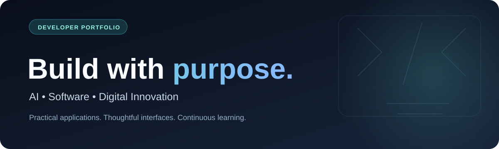

# Hi, I'm Sandu Venkata Siva Ramakrishna 👋

### AI Applications · Software Engineering · Digital Product Design

**I build practical, visually thoughtful applications that turn complex ideas into approachable user experiences.**

---

## ✨ A little about me

- 🧠 Interested in **AI-assisted products**, real-world problem solving and responsible AI integration.
- 💻 Building with **React, TypeScript, Flutter and Dart**.
- 🎨 Focused on polished user interfaces, usability and accessible experiences.
- 🌱 Learning through hands-on projects in **civic technology, agriculture, personal finance and digital wellness**.
- 🤝 Open to professional collaboration, thoughtful feedback and learning opportunities.

## 🛠️ Technologies I use

| Area | Tools |
| --- | --- |
| **App development** | Flutter · Dart · Provider |
| **Web development** | React · TypeScript · JavaScript · Vite · Tailwind CSS |
| **Visualization & UX** | Framer Motion · Leaflet · Recharts · FL Chart |
| **Tools & practices** | Git · GitHub · project documentation · automated checks |
| **AI exploration** | Groq integrations · conversational interfaces · AI-assisted user flows |

## 🚀 Featured GitHub projects

<table>
<tr>
<td width="50%" valign="top">

<h3>LEO.AI · Civic assistance</h3>

React/TypeScript prototype for reporting and understanding local civic problems, with AI-assisted categorization, map exploration, and three-language support.

<b>React · TypeScript · Leaflet · Groq (optional)</b>

<a href="https://leo-ai-pi.vercel.app/">🌐 Website</a> · <a href="https://github.com/svsramakrishnanaidu-rgb/leo-ai">📁 Source code</a>

Independent browser-local prototype; not a government reporting platform.

</td>
<td width="50%" valign="top">

<h3>FinTrack · Premium expense tracker</h3>

Offline-first Flutter application for capturing expenses, exploring spending by category, and viewing insights in light and AMOLED-inspired dark themes.

<b>Flutter · Dart · Provider · FL Chart</b>

<a href="https://github.com/svsramakrishnanaidu-rgb/fin-tracker#app-preview">📱 App screenshots</a> · <a href="https://github.com/svsramakrishnanaidu-rgb/fin-tracker">📁 Source code</a>

No verified publicly deployed FinTrack website yet; local Flutter web development is supported.

</td>
</tr>
</table>

### 🧠 LEO 2.0 AI — Engineering workspace

A separate planned **permission-based multimodal AI assistant**. Its repository now includes structured system architecture, UI/UX design, Android consent models, APIs/knowledge strategy, automation workflows and a reference consent-policy test suite.

[**Explore LEO 2.0 →**](https://github.com/svsramakrishnanaidu-rgb/leo2.0ai) · [Architecture →](https://github.com/svsramakrishnanaidu-rgb/leo2.0ai/blob/main/docs/ARCHITECTURE.md)

*Development specification and scaffolding; not a deployed autonomous AI application.*

### 📚 BSR Learning

My [BSR Learning](https://github.com/svsramakrishnanaidu-rgb/bsr-learning) repository documents a learning roadmap and links to my projects. It's a work-in-progress workspace, not a completed tutorial collection.

## 🌐 Additional websites and previews

These website links were previously supplied by me as part of my project work. Their source code is **not currently in the GitHub repositories connected to this account**.

| Project | Focus | Open |
| --- | --- | --- |
| 🌾 **DHRUVA AI** | Smart agriculture guidance and farming tools | [Visit website](https://dhruvaai.lovable.app/) |
| 🧭 **GuideMaster AI** | AI-oriented travel and itinerary planning | [Visit website](https://journey-mood-ai.lovable.app/) |
| 🌱 **Agro Visions 3D** | Interactive agricultural advisory experience | [Open project preview](https://preview--agro-visions-3d.lovable.app/) |

The Agro Visions URL is a preview link and may be temporary or access-restricted. Current availability of external deployments has not been independently verified.

## 🔬 Ideas I'm exploring

**AyurOcto** — a traditional healthcare and wellness education concept exploring Ayurveda, herbs, yoga, nutrition and thoughtful visual design. No verified public deployment or connected source repository is currently available.

## 📌 My approach

**Build something useful.** Understand the problem before designing the solution.

**Make it clear.** Good documentation, accessible design and honest product descriptions matter.

**Keep improving.** Prefer meaningful, tested progress over unnecessary commits or inflated statistics.

---

### Let's connect and build meaningful things.

<a href="https://www.linkedin.com/in/s-v-s-ramakrishna-naidu-39611a444/">LinkedIn</a> · <a href="https://github.com/svsramakrishnanaidu-rgb">GitHub</a> · <a href="https://github.com/svsramakrishnanaidu-rgb/bsr-learning/blob/main/PROJECTS.md">Complete project portfolio</a>

AI • Software • Digital Innovation

