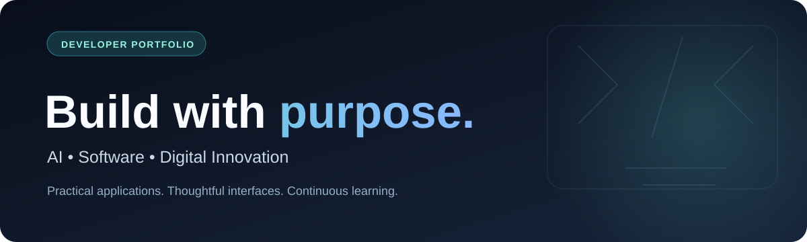

<div align="center">


# BSR Learning
**Learning in public. Building practical software. Documenting the journey.**

[**Explore projects & live links →**](PROJECTS.md) · [**Developer profile design →**](PROFILE_README.md) · [**LEO.AI →**](https://github.com/svsramakrishnanaidu-rgb/leo-ai) · [**FinTrack →**](https://github.com/svsramakrishnanaidu-rgb/fin-tracker)
</div>

---

## Welcome

This repository is a **work-in-progress learning workspace** maintained by **Sandu Venkata Siva Ramakrishna**. It is intended to organize future notes, exercises, and reproducible projects around modern web development and AI-assisted applications.

**Current status:** This repository mainly hosts learning plans and a portfolio catalog. It is not presented as a completed tutorial library.

## Selected projects

| Project | Focus | Website / preview | Source |
| --- | --- | --- | --- |
| **LEO 2.0 AI** | Consent-based personal AI assistant (engineering specification + policy reference) | [Architecture + workflows](https://github.com/svsramakrishnanaidu-rgb/leo2.0ai) *(not deployed)* | [Repository](https://github.com/svsramakrishnanaidu-rgb/leo2.0ai) |
| **LEO.AI** | AI-assisted civic reporting prototype | [Visit website](https://leo-ai-pi.vercel.app/) | [Repository](https://github.com/svsramakrishnanaidu-rgb/leo-ai) |
| **FinTrack** | Flutter offline expense tracker | [UI screenshots](https://github.com/svsramakrishnanaidu-rgb/fin-tracker#app-preview) *(no verified hosted site)* | [Repository](https://github.com/svsramakrishnanaidu-rgb/fin-tracker) |
| **DHRUVA AI** | Agriculture-focused AI guidance | [Visit website](https://dhruvaai.lovable.app/) | Not in connected repositories |
| **GuideMaster AI** | AI-focused travel planning | [Visit website](https://journey-mood-ai.lovable.app/) | Not in connected repositories |
| **Agro Visions 3D** | Interactive agriculture advisory concept | [Preview website](https://preview--agro-visions-3d.lovable.app/) | Not in connected repositories |

**See the [full portfolio](PROJECTS.md)** for descriptions, stack, purpose, limitations and more project information—including AyurOcto as a concept project.

*The external website URLs are project links previously provided by the creator; current availability was not independently verified. LEO.AI is an independent prototype, not an official government portal.*

## Learning roadmap

| Learning track | Focus areas |
| --- | --- |
| Frontend foundations | Semantic HTML, accessible CSS, JavaScript fundamentals |
| React + TypeScript | Components, routing, state, UI quality |
| Flutter & Dart | Mobile-first design, local persistence, testing |
| AI applications | Responsible AI integration and API security |
| Developer workflow | Version control, documentation, testing, CI |

## Intended organization

As real learning examples are added, they'll be grouped by topic and documented individually. The folder names below are a **future plan**, not a claim that these folders exist yet.

```text
foundations/       ← HTML, CSS and JavaScript
react-typescript/  ← Frontend examples
flutter-dart/      ← Mobile development
ai-projects/       ← AI integrations
notes/             ← Explanations and references
```

## Connect

- [GitHub — @svsramakrishnanaidu-rgb](https://github.com/svsramakrishnanaidu-rgb)
- [LinkedIn — S. V. S. Ramakrishna Naidu](https://www.linkedin.com/in/s-v-s-ramakrishna-naidu-39611a444/)
- [Portfolio project catalog](PROJECTS.md)

<div align="center"><sub>Build with purpose • Share what works • Keep learning</sub></div>
